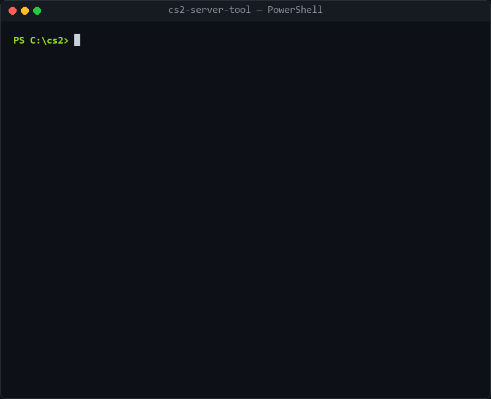
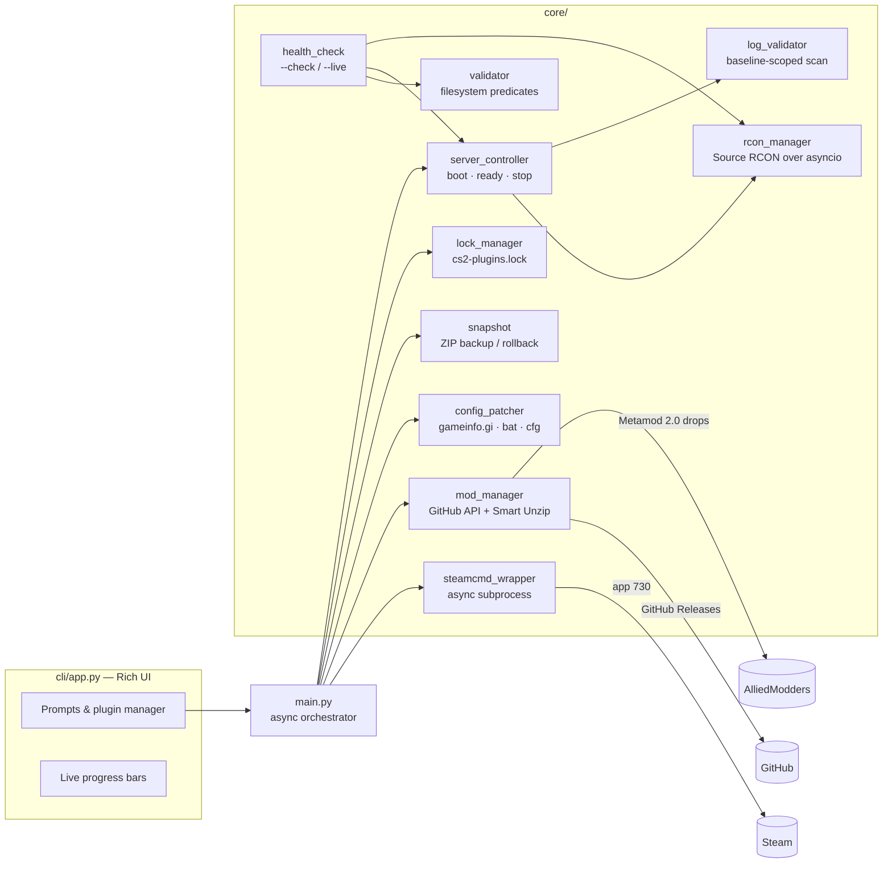
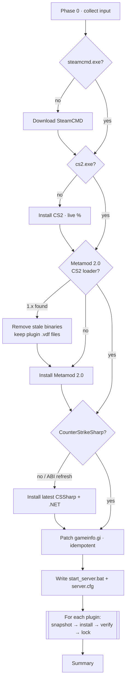
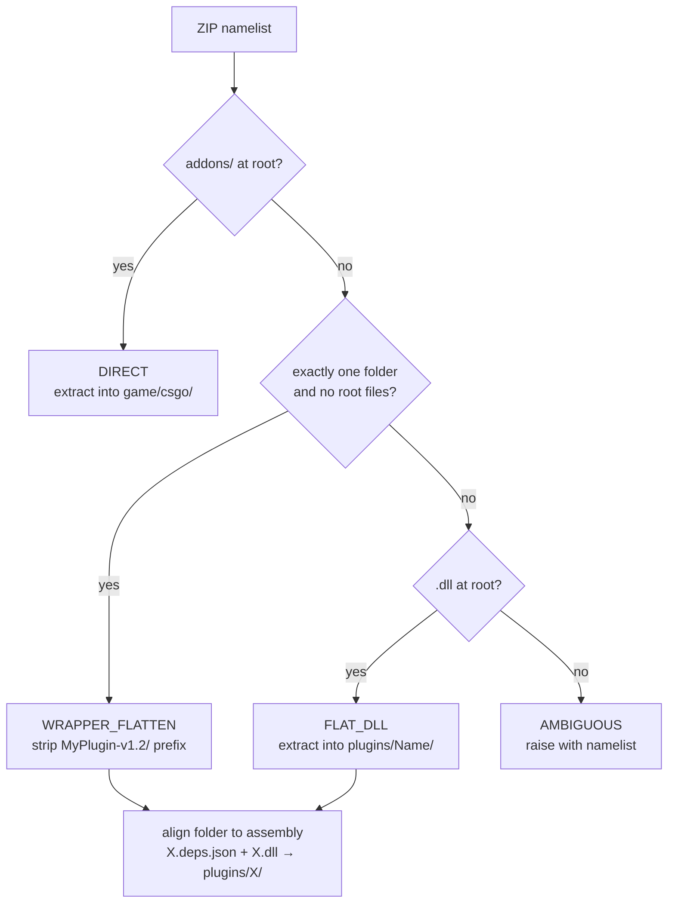
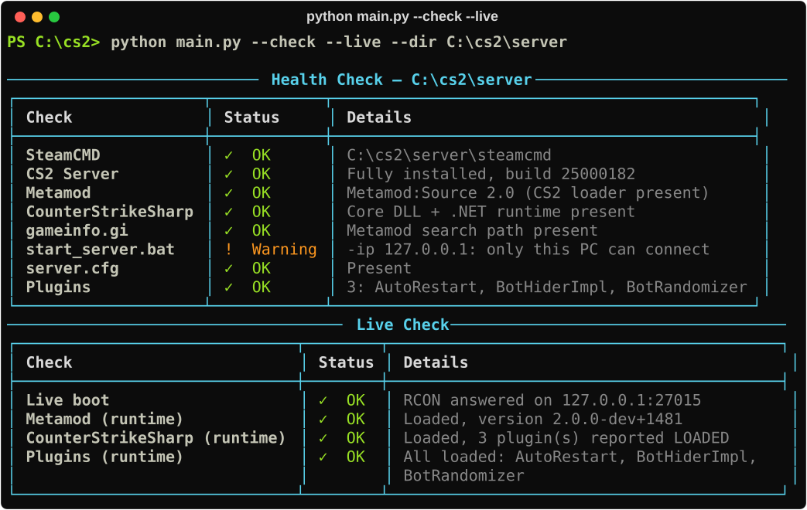
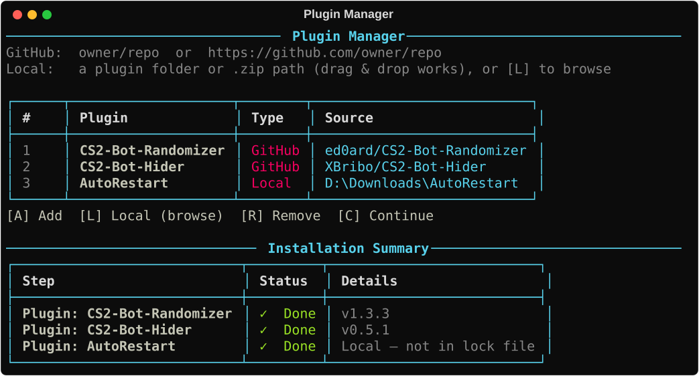
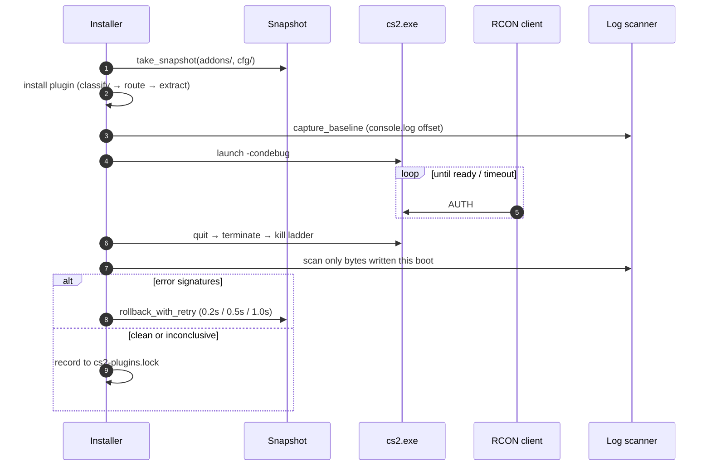

<div align="center">

# 🎮 CS2 Server Creator

### One command from an empty folder to a modded, verified Counter-Strike 2 server.

SteamCMD · CS2 Dedicated Server · Metamod:Source 2.0 · CounterStrikeSharp · any GitHub or local plugin

<br>

[](https://github.com/AkoSuminoe/Cs2_AwpLego_Server_Creator/actions/workflows/tests.yml)
[](tests/)
[](tests/)
[](https://python.org)
[](https://docs.python.org/3/library/asyncio.html)
[](#-requirements)
[](LICENSE)

<br>



<sub>Real run: <code>--check --live</code> boots the server, proves Metamod 2.0 + CounterStrikeSharp + every plugin actually loaded, then shuts it down.</sub>

<br><br>

[⚡ Quick Start](#-quick-start) · [✨ Highlights](#-engineering-highlights) · [🧱 Architecture](#-architecture) · [🩺 Health Check](#-health-check) · [🔌 Plugins](#-plugins-github-or-local) · [🧪 Tests](#-testing)

</div>

---

## 📖 The problem

Setting up a CS2 community server by hand takes hours. You download SteamCMD and pull 60+ GB of game files. You find the *right* Metamod build: GitHub's "latest" release is the Source 1 branch and silently does nothing on CS2. You patch `gameinfo.gi` and unzip CounterStrikeSharp into the correct tree. Then every plugin ships its ZIP in a different layout. One wrong folder and nothing loads, with no error on screen.

**This tool automates the whole pipeline, idempotently.** Re-run it at any time: finished steps are detected from the filesystem and skipped. Then **`--check --live` proves the result**: it boots the real server and confirms every component loaded.

---

## ✨ Engineering highlights

| | |
|---|---|
| ⚙️ **Async orchestration** | A 9-phase `asyncio` pipeline. SteamCMD output is streamed line by line into live progress bars; downloads are chunk-streamed with `httpx`. |
| 📦 **Smart Unzip classifier** | A pure function inspects a ZIP's `namelist()` **before extracting a byte** and routes it as DIRECT / WRAPPER / FLAT, so no layout is hardcoded per plugin. |
| 🧭 **Engine-aware installs** | Picks Windows assets over Linux ones and renames plugin folders to match the assembly (`plugins/X/X.dll`), the rule CounterStrikeSharp silently enforces. |
| 🛡️ **Self-healing** | Atomic ZIP snapshot before every plugin; automatic rollback on failure; a Windows file-handle backoff ladder for locked DLLs. |
| 🔬 **Runtime verification** | Boots `cs2.exe`, polls a hand-written **Source RCON** client until ready, scans only the log bytes produced by this boot, and rolls back on confirmed errors only. |
| 🩺 **Health check** | `--check` (static, seconds) + `--live` (real boot). It caught real bugs during development: a Source 1 Metamod build, a SourceHook ABI mismatch and misnamed plugin folders. |
| 🔒 **Reproducible servers** | `cs2-plugins.lock` pins every plugin by version, commit and URL; `--restore` rebuilds an identical plugin set anywhere. |
| ⚛️ **Crash-safe state** | All state files are written via temp file + `os.replace()`, so a crash never leaves them half-written. |
| 🧪 **Fully offline tests** | **260 tests, 88% coverage, < 1 s.** HTTP via `httpx.MockTransport`, RCON via asyncio stream fakes, process lifecycle via a scripted subprocess double. CI enforces ≥ 80%. |

---

## 🧱 Architecture



### Install pipeline



### Smart Unzip decision tree



---

## ⚡ Quick start

```bash
git clone https://github.com/AkoSuminoe/Cs2_AwpLego_Server_Creator.git
cd Cs2_AwpLego_Server_Creator
pip install -r requirements.txt

python main.py                      # interactive full install
```

| Command | What it does |
|---|---|
| `python main.py` | Full install: SteamCMD → CS2 → Metamod 2.0 → CounterStrikeSharp → configs → plugins |
| `python main.py --verify` | Same, and boots the server after each plugin to prove it loads (auto-rollback on errors) |
| `python main.py --add-plugin <repo \| URL \| path> --dir <server>` | Add plugins to an existing server, no prompts (repeatable) |
| `python main.py --check --dir <server>` | Static health check, read-only, in seconds |
| `python main.py --check --live --dir <server>` | Boot the server and confirm Metamod, CSSharp and every plugin loaded |
| `python main.py --update --dir <server>` | Update CS2 via SteamCMD and re-apply the `gameinfo.gi` patch that updates wipe |
| `python main.py --restore` | Reinstall the exact plugin set pinned in `cs2-plugins.lock` |

The interactive installer asks for: install directory, Steam GSLT + Web API key, IP / port / map, RCON password, optional MySQL, and plugins.

---

## 🩺 Health check



**`--check`** reads files only:
- CS2 build and Steam state.
- Metamod **2.0** (the CS2 loader, not the Source 1-only 1.x build).
- CounterStrikeSharp, its `.NET` runtime and its Metamod registration.
- The `gameinfo.gi` patch.
- `start_server.bat` flags (loopback IP, legacy RCON flag, missing GSLT).
- Plugin folders.

**`--live`** additionally boots the server with the settings from `start_server.bat`:
1. Waits for RCON.
2. Asks `meta version` and `css_plugins list`.
3. Cross-checks the console and CSSharp logs written **during this boot only**.
4. Names any plugin that is installed but did not load.
5. Shuts the server down.

The exit code is `1` on any failure, so it drops straight into scripts and CI.

---

## 🔌 Plugins: GitHub or local



| Source | Example |
|---|---|
| GitHub slug | `XBribo/CS2-Bot-Hider` |
| GitHub URL | `https://github.com/ed0ard/CS2-Bot-Randomizer` |
| Local folder or `.zip` | `D:\Downloads\AutoRestart` (type it, drag & drop it, or press **[L]** for a file picker) |

GitHub plugins resolve to the **latest release**: the Windows asset is preferred over Linux, the release is recorded in the lock file, and it is restorable with `--restore`. Local plugins go through the **same classifier and routing**, so they land exactly where a GitHub install would. Every install is wrapped in a snapshot and rolls back on failure.

```bash
python main.py --dir C:\cs2\server \
  --add-plugin https://github.com/ed0ard/CS2-Bot-Randomizer \
  --add-plugin XBribo/CS2-Bot-Hider
python main.py --dir C:\cs2\server --add-plugin "D:\Downloads\AutoRestart"
python main.py --dir C:\cs2\server --check --live   # → All loaded: AutoRestart, BotHiderImpl, BotRandomizer
```

---

## 🔬 Runtime verification



- **Rollback only on evidence.** Rollback happens only on confirmed signatures (`Exception`, `Failed to load plugin`, `[Error]`). A timeout never destroys a healthy install.
- **Baseline scoping.** Only log output from this boot is scanned. `console.log` is read from the first Game search path, which becomes `csgo/addons/metamod/` once Metamod is hooked.
- **Port-collision safety.** If a server already answers RCON on the port, no second `cs2.exe` is launched.

---

## 🎛️ Async RCON client

A dependency-free implementation of the Source RCON wire protocol over `asyncio` TCP:

```python
async with RCONClient(host="127.0.0.1", port=27015, password="secret") as rcon:
    await rcon.add_admin("76561198000000000", "@css/root")
    await rcon.change_map("de_mirage")
    await rcon.broadcast("Restart in 5 minutes.")
```

```
[int32 LE] size = len(body) + 10 │ [int32 LE] id │ [int32 LE] type (3 AUTH · 2 EXEC · 0 RESPONSE) │ body\0 │ \0
```

---

## 🔒 Lock file & restore

```json
{
  "schema_version": 1,
  "entries": {
    "XBribo/CS2-Bot-Hider": {
      "owner": "XBribo",
      "repo": "CS2-Bot-Hider",
      "version": "v0.5.1",
      "commit_ref": "12069c25a756deedc72f8fc116ac3b18045d1223",
      "download_url": "https://github.com/XBribo/CS2-Bot-Hider/releases/download/v0.5.1/BotHider-Windows-0.5.1.zip",
      "asset_keyword": null,
      "installed_at": "2026-10-15T13:32:37.721578Z"
    }
  }
}
```

`python main.py --restore` reinstalls every entry from its **pinned URL** (no "latest" lookup), producing an identical plugin set on any machine.

---

## 🧪 Testing

```bash
pytest --cov=core --cov=models --cov-report=term-missing
```

- **260 tests in under a second, fully offline.** No network, no sockets, no real processes.
- **Covered areas:**
  - The Smart Unzip decision tree, including real-world regressions (a `lang/` folder next to the DLLs, a Linux asset listed first, a repo name ≠ assembly name).
  - The GitHub resolver and the Metamod 2.0 drop-server resolver.
  - Streaming downloads and snapshot rollback.
  - The RCON wire codec and timeouts.
  - The process shutdown escalation ladder and baseline-scoped log scanning.
  - Static and live health checks.
- **CI** (GitHub Actions) fails under 80% coverage. Current: **88%**.

| Module | Coverage |
|---|---|
| `models/schemas.py` | 98% |
| `core/log_validator.py` | 94% |
| `core/rcon_manager.py` | 94% |
| `core/server_controller.py` | 94% |
| `core/mod_manager.py` | 92% |
| `core/health_check.py` | 87% |

README media is generated from a real install by [`docs/media/render.py`](docs/media/render.py), with paths anonymized.

---

## 📋 Requirements

- Python 3.10+
- Windows (the CS2 dedicated server binary); the Python code itself is OS-agnostic
- A Steam [Game Server Login Token](https://steamcommunity.com/dev/managegameservers) (GSLT) and [Web API key](https://steamcommunity.com/dev/apikey)

<details>
<summary><b>🌐 Network & port forwarding</b></summary>

<br>

Open the game port (default `27015`) as Administrator:

```cmd
netsh advfirewall firewall add rule name="CS2 Server UDP" protocol=UDP dir=in localport=27015 action=allow
netsh advfirewall firewall add rule name="CS2 Server TCP" protocol=TCP dir=in localport=27015 action=allow
```

Forward UDP + TCP `27015` on your router to the server's LAN IP. Use `0.0.0.0` or the LAN IP as the server IP; `127.0.0.1` only accepts local connections (`--check` warns about this).

</details>

<details>
<summary><b>🗄️ MySQL for plugins (Ranks, VIP, Stats, Bans)</b></summary>

<br>

Answer `y` at the database prompt and the tool atomically writes `addons/counterstrikesharp/configs/databases.json`:

```json
{ "default": { "Host": "127.0.0.1", "Port": 3306, "User": "root", "Password": "…", "Database": "cs2_server" } }
```

Every CSSharp plugin that follows the convention reads the `"default"` key. The quickest local setup is [XAMPP](https://www.apachefriends.org/): start MySQL and create the database. Set a root password before exposing port 3306.

</details>

<details>
<summary><b>🩹 Troubleshooting</b></summary>

<br>

| Symptom | Cause & fix |
|---|---|
| Window title shows **"Select …"** and nothing responds | QuickEdit mode paused the console. Press `Esc`. |
| Can't paste a token | In classic CMD, paste with **right-click**. |
| "Install CS2 Server" sits at 0% | SteamCMD's self-update and disk pre-allocation print no percentages. Watch the dim status line. |
| `--check --live`: *CounterStrikeSharp rejected (old SourceHook)* | CSSharp is older than Metamod. Re-run the installer, which refreshes it. |
| `--check --live`: *Installed but not loaded: X* | Check `addons/counterstrikesharp/logs/` for X's exception (usually an API-version mismatch). |

</details>

---

## 🧰 Tech stack

**Python 3.10+** · `asyncio` · [`httpx`](https://www.python-httpx.org/) (async streaming HTTP) · [`rich`](https://rich.readthedocs.io/) (terminal UI) · [`tenacity`](https://tenacity.readthedocs.io/) (retry/backoff) · `zipfile` · `struct` · `pytest` + `pytest-cov` · GitHub Actions

## 📄 License

MIT — see [LICENSE](LICENSE).
